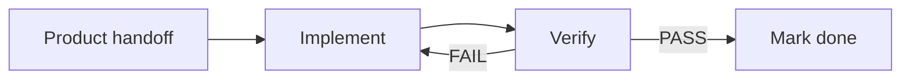

# Self-recruitment agent orchestration

Three **project Cursor Agent Skills** implement [PRD-self-recruitment.md](./PRD-self-recruitment.md) and [issues-P0-self-recruitment.md](./issues-P0-self-recruitment.md). All work obeys **D-1～D-4** (PRD §3).

| Skill | Path | Role |
|-------|------|------|
| **self-recruitment-product** | `.cursor/skills/self-recruitment-product/SKILL.md` | Specs, handoffs, copy outlines, issue status |
| **self-recruitment-implement** | `.cursor/skills/self-recruitment-implement/SKILL.md` | Static H5 + data pipeline code |
| **self-recruitment-verify** | `.cursor/skills/self-recruitment-verify/SKILL.md` | Acceptance + decision compliance gate |

Skills use `disable-model-invocation: true`—invoke them **by name** in chat.

---

## When to use which agent

| Situation | Agent |
|-----------|--------|
| Pick next P0, clarify scope, UI copy, acceptance mapping | **product** |
| Write/edit `self-recruitment/**` or related `scripts/` / `docs` per issue | **implement** |
| Post-implementation QA, pre-merge check, audit issue ID | **verify** |
| Update issue `Status` or tick checkboxes after PASS | **product** (or human), not before **verify** PASS |

---

## Standard delivery loop

```text
1. Product  → handoff for one issue ID (respect dependencies)
2. Implement → minimal diff + “Ready for verify”
3. Verify   → PASS/FAIL report
4. If FAIL → Implement (fix) → Verify again
5. If PASS → Product or human marks issue done / ticks checkboxes
```



**Order hint**: Follow the dependency graph in `issues-P0-self-recruitment.md` (e.g. V1-P0-08 before V2-P0-01).

---

## How to phrase prompts

Reference the skill explicitly so Cursor loads the skill instructions:

| Goal | Example prompt |
|------|----------------|
| Brief | `@self-recruitment-product` Hand off **V1-P0-01** with UI copy outline and acceptance mapping. |
| Build | `@self-recruitment-implement` Implement **V1-P0-01** from the last handoff; minimize diff. |
| QA | `@self-recruitment-verify` Verify **V1-P0-01** against current uncommitted changes (FAIL if any blocker). |
| Status | `@self-recruitment-product` Set **V1-P0-01** status to `done` (verify already PASS). |

You can combine: e.g. implement then verify in one session by chaining two `@` skill invocations.

---

## Decision quick reference (D-1～D-4)

| # | One line |
|---|----------|
| D-1 | Static H5 + pipeline + Pages; no subscription/backend; `fetchedAt` + static changelog |
| D-2 | Default **conservative** mapping; 冲/稳/保 not probability % |
| D-3 | No港澳/D类简版 IA; official links only |
| D-4 | Monorepo brand + data schema +校名归一/supplement alignment |

Full text: PRD §3.

---

## Related project rule

When editing `self-recruitment/**` or `docs/**` for this product, Cursor may attach `.cursor/rules/self-recruitment-agents.mdc` (pointer back to this doc).

---

## P0 index

18 issues: V1 **V1-P0-01…09**, V2 **V2-P0-01…09** — titles in [issues-P0-self-recruitment.md](./issues-P0-self-recruitment.md#p0-标题速查表).