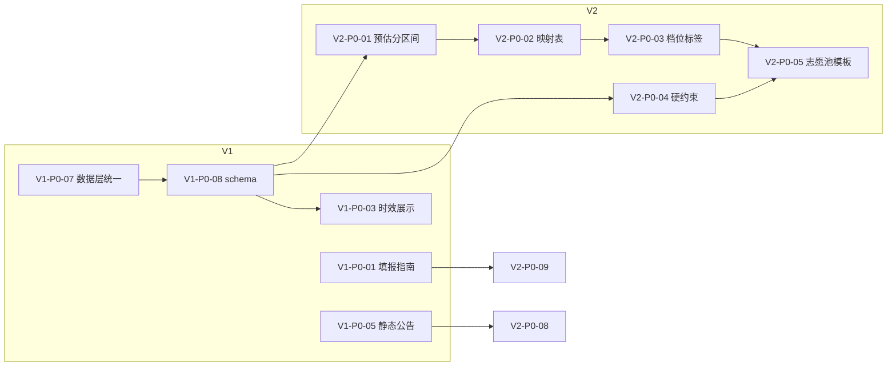

# P0 Issue 清单 — 深圳普高自主招生选校（V1 / V2）

> **用途**：供产品/研发拆分为 GitHub Issues；**本文不自动创建 Issue**。  
> **约束**：须符合 PRD 第 3 章决策 **D-1～D-4**（见 `docs/PRD-self-recruitment.md`）。  
> **汇总**：共 **18** 条 P0（V1：**9** 条；V2：**9** 条）。

---

## 使用说明

每条包含：**标题**、**描述**、**验收标准**、**建议 Labels**、**依赖**。

---

## V1 P0（懂路径、数据可信、品牌统一）

### V1-P0-01 新增「填报指南 / 升学路径」静态专题入口

**Status**: done  
**Handoff**: `docs/handoffs/V1-P0-01.md`

**描述**
在三 Tab 导航旁增加第四入口，承载统招 / 自招 / 名额分配 / 补录的 **静态说明**（无后端 CMS）。内容链到官方 PDF/招考网，与 `rules.js` 名词保持一致，避免两套文案。

**验收标准**

- [x] 导航可见且移动端不挤占核心筛选项
- [x] 至少覆盖四条路径：统招批次结构、自招报名渠道（一类平台/二类现场）、名额分配资格线含义、补录/二批/三批查询指引
- [x] 每条路径含「常见误区」1 条，并与规则弹窗交叉引用
- [x] 纯静态资源，可随 `index.html` 或独立 `guide.html` 部署

**Labels**：`p0`, `v1`, `content`, `ia`  
**依赖**：无  

---

### V1-P0-02 深圳中考政策年度时间轴（静态）

**描述**  
以时间轴组件展示当年关键节点（报名、填志愿、出分、划线、补录等）。日期支持 **年度配置 JSON** 随发版更新，不依赖服务端调度。

**验收标准**

- [ ] 时间轴数据来自仓库内 `data/timeline-YYYY.json`（或等价），CI 一并发布  
- [ ] 过期节点与未发生节点视觉区分；含「以教育局最新通知为准」  
- [ ] 与填报指南互相链接  
- [ ] 无 API 调用  

**Labels**：`p0`, `v1`, `content`, `static`  
**依赖**：V1-P0-01（可并行，联调前需入口）  

---

### V1-P0-03 数据时效与来源全页显性化

**描述**  
在页脚及每个 Tab 筛选区展示 `year`、`fetchedAt`、权威 `source.url`。满足 D-1「无推送」下的信任替代方案。

**验收标准**

- [ ] `ZZZS_DATA` / `SCORES_DATA` 的 meta 字段在 UI 可见  
- [ ] 数据缺失 `fetchedAt` 时构建脚本失败或告警  
- [ ] 移动端折叠区仍可一键看到来源链接  

**Labels**：`p0`, `v1`, `data`, `ux`  
**依赖**：V1-P0-08（schema 字段）  

---

### V1-P0-04 FAQ 与规则同源维护机制

**描述**  
建立 `rules` 与 FAQ 的 **单一事实来源**（如共享片段或生成步骤），聚焦「自招控制分 ≠ 一批线」「名额分配 ≠ 到校指标分」等高发误区。

**验收标准**

- [ ] 文档或脚本说明如何从同源生成/校验规则与 FAQ  
- [ ] 填报指南内 FAQ 不少于 8 条，每条可锚点跳转  
- [ ] PR 修改规则时必须同步 FAQ（CI 或 checklist）  

**Labels**：`p0`, `v1`, `content`, `dx`  
**依赖**：V1-P0-01  

---

### V1-P0-05 静态「更新公告」区块（替代订阅推送）

**描述**  
落实 **D-1**：每次数据发版在站内展示 **CHANGELOG 摘要**（校名修正、分数线变更、节点日期变更），不建设订阅后端。

**验收标准**

- [ ] `docs/CHANGELOG-self-recruitment.md` 或 `data/changelog.json` 可被页面只读渲染  
- [ ] 最近一次发版日期与 git tag / 部署时间一致  
- [ ] 提供「如何获取更新」说明：关注公众号/社群/拉取 Pages，而非 App 内订阅  

**Labels**：`p0`, `v1`, `ops`, `static`  
**依赖**：V1-P0-03  

---

### V1-P0-06 品牌与设计令牌与仓库兄弟应用对齐（D-4）

**描述**  
统一产品标题、主题色、页脚免责声明模版、数据来源展示格式；抽取可复用 CSS 变量或共享 `branding.md` 规范。

**验收标准**

- [ ] 与 monorepo 内其他子应用比对：title/meta theme-color/页脚文案一致或可配置同一份  
- [ ] 文档记录品牌令牌路径与使用方式  
- [ ] 不改变现网「深圳普高自主招生选校」主标题  

**Labels**：`p0`, `v1`, `brand`, `monorepo`  
**依赖**：无  

---

### V1-P0-07 共享数据层：校名归一与 supplement 流程（D-4）

**描述**  
将 `normSchoolName`、别名表、`supplement.json` 修正流程文档化；确保自招表与分数线表关联不因年度切换断裂。

**验收标准**

- [ ] 仓库级 `data/school-aliases.json`（或约定路径）被 fetch 脚本消费  
- [ ] 运营 SOP 写明 supplement 提交流程与 QA 抽检 10 校  
- [ ] 构建时出现无法关联的校名列出报告并阻断发版（可配置 warn/fail）  

**Labels**：`p0`, `v1`, `data`, `pipeline`  
**依赖**：无  

---

### V1-P0-08 分数线 schema 强制 `scoreKind` 与年度字段

**描述**  
数据结构层面区分资格线/录取线，支撑 UI 色标与推荐引擎 Layer 1。

**验收标准**

- [ ] `scores-*.json` 每条分数含 `scoreKind`（枚举校验）  
- [ ] 构建脚本校验失败则 CI 不通过  
- [ ] 现有 UI 在缺失 kind 时不再静默展示（降级为「待标注」）  

**Labels**：`p0`, `v1`, `data`, `schema`  
**依赖**：V1-P0-07  

---

### V1-P0-09 升学季 QA 检查清单与发版 Runbook

**描述**  
将 PRD 7.3 SOP 固化为可勾选自检表 + `deploy.ps1` / workflow 备注，保证 24–72h 发版 SLA。

**验收标准**

- [ ] `docs/runbook-data-release.md` 含监测→抓取→QA→发布→回滚五步  
- [ ] QA 清单含二类双控制分、民办收费、三线对照样本校  
- [ ] GitHub Actions workflow 注释链到 runbook  

**Labels**：`p0`, `v1`, `ops`, `docs`  
**依赖**：V1-P0-05  

---

## V2 P0（能算、保守默认、仍纯静态）

### V2-P0-01 mock/期末分 → 预估中考分区间（前端）

**描述**  
新增输入：mock 类型 + 折算分；输出点估计与区间；**默认展示保守端**（D-2）。数据不上传服务端。

**验收标准**

- [ ] 支持至少三种 mock 类型（期末/一模/二模）对应 σ 查表  
- [ ] `shared.myScore` 扩展为 `{ point, low, high, source, riskPreset }` 且 URL 可分享（长度可控）  
- [ ] 首屏默认 `riskPreset=conservative`  
- [ ] 切换中性/乐观需二次确认风险提示  
- [ ] 无网络写操作、无登录  

**Labels**：`p0`, `v2`, `feature`, `static`  
**依赖**：V1-P0-08  

---

### V2-P0-02 保守档映射规则表版本化（纯数据）

**描述**  
将 `a, b, σ` 与档位 preset 存于 `data/mapping-v1.json`，随发版更新，可审计；首版采用专家缺省并文档说明校准计划。

**验收标准**

- [ ] 规则表含 `version`、`effectiveYear`、变更说明  
- [ ] 前端推荐仅读取 JSON，无硬编码 magic number  
- [ ] 默认 preset 名为 `conservative`  

**Labels**：`p0`, `v2`, `data`, `reco`  
**依赖**：V2-P0-01  

---

### V2-P0-03 列表「可达档位」标注（非概率）

**描述**  
在一批/自招列表基于区间与线别打出冲/稳/保/不推荐标签；用语禁止「录取概率 %」。

**验收标准**

- [ ] 标签逻辑可追溯到规则 ID + 所用分数线字段  
- [ ] 灰显逻辑与现「未达到」一致且兼容区间  
- [ ] 免责声明在首次出现标签时展示一次  

**Labels**：`p0`, `v2`, `feature`, `reco`  
**依赖**：V2-P0-01、V2-P0-02  

---

### V2-P0-04 推荐引擎 Layer 1 硬约束模块（纯 JS）

**描述**  
实现 AC/D 可比集合、自招门槛、1 校 1 项目提示、预算上限（可选输入）等硬过滤，输出可解释拒绝原因。

**验收标准**

- [ ] 模块单测或固定样例输入输出文档  
- [ ] 与 `rules.js` 约束文案一致  
- [ ] **不实现** D 类简版 IA（D-3）；仅使用既有类别筛选  

**Labels**：`p0`, `v2`, `reco`, `static`  
**依赖**：V1-P0-08  

---

### V2-P0-05 冲 2 / 稳 3 / 保 2 志愿池模板（保守默认）

**描述**  
基于保守区间生成志愿候选池结构，供家长打印/复制；非官方志愿表代填。

**验收标准**

- [ ] 默认按保守档生成；切换档位会重算并提示  
- [ ] 导出为前端打印样式或复制 Markdown  
- [ ] 附「若自招录取则后续批次作废」固定文案  
- [ ] 静态实现，无 PDF 服务端  

**Labels**：`p0`, `v2`, `feature`, `reco`  
**依赖**：V2-P0-03、V2-P0-04  

---

### V2-P0-06 性能：分数线数据按 batch 懒加载（可选 P0 技术债）

**描述**  
缓解 `scores-data.js` 体积导致的低端机卡顿；须保持纯静态与离线单文件策略可配置。

**验收标准**

- [ ] 首屏仅加载当前 Tab 所需 batch 数据  
- [ ] `build_single.py` 仍可生成全量单文件（开关）  
- [ ] 4G 测速首屏可交互 <3s（目标机型文档记录）  

**Labels**：`p0`, `v2`, `perf`, `tech-debt`  
**依赖**：无（可与功能并行）  

---

### V2-P0-07 推荐/梯度页强制免责声明与合规文案复核

**描述**  
落实 PRD 第 9 章：推荐结果不构成录取承诺；强化数据误差说明。

**验收标准**

- [ ] 进入推荐/梯度前或首次使用时 modal/条可见且需确认  
- [ ] 文案经产品/legal  checklist  
- [ ] 与页脚声明不矛盾  

**Labels**：`p0`, `v2`, `compliance`  
**依赖**：V2-P0-03  

---

### V2-P0-08 明确排除项：后端订阅与账号（D-1 验收）

**描述**  
在架构与 Issue 模板中 **验收「零后端」**：无用户库、无 Webhook 推送、无邮件订阅 API。

**验收标准**

- [ ] 仓库无新增 serverless 订阅类依赖用于本产品  
- [ ] PR 模板含「是否引入后端」勾选，默认否  
- [ ] 更新触达文档指向 V1-P0-05 静态公告 + 社群  

**Labels**：`p0`, `v2`, `architecture`, `d1`  
**依赖**：V1-P0-05  

---

### V2-P0-09 明确排除项：无港澳/D 类简版（D-3 验收）

**描述**  
验收 IA 与推荐逻辑未新增「港澳家庭向导」「D 类专区简版」；保留标准 AC/D 筛选即可。

**验收标准**

- [ ] IA 审计无新增上述入口  
- [ ] 用户调研文档注明 scope 排除项  
- [ ] 若搜索/外链需求，仅在 FAQ 链官方政策  

**Labels**：`p0`, `v2`, `scope`, `d3`  
**依赖**：V1-P0-01  

---

## 依赖关系简图

---

## P0 标题速查表

| ID | 标题 |
|----|------|
| V1-P0-01 | 新增「填报指南 / 升学路径」静态专题入口 |
| V1-P0-02 | 深圳中考政策年度时间轴（静态） |
| V1-P0-03 | 数据时效与来源全页显性化 |
| V1-P0-04 | FAQ 与规则同源维护机制 |
| V1-P0-05 | 静态「更新公告」区块（替代订阅推送） |
| V1-P0-06 | 品牌与设计令牌与仓库兄弟应用对齐（D-4） |
| V1-P0-07 | 共享数据层：校名归一与 supplement 流程（D-4） |
| V1-P0-08 | 分数线 schema 强制 scoreKind 与年度字段 |
| V1-P0-09 | 升学季 QA 检查清单与发版 Runbook |
| V2-P0-01 | mock/期末分 → 预估中考分区间（前端） |
| V2-P0-02 | 保守档映射规则表版本化（纯数据） |
| V2-P0-03 | 列表「可达档位」标注（非概率） |
| V2-P0-04 | 推荐引擎 Layer 1 硬约束模块（纯 JS） |
| V2-P0-05 | 冲 2 / 稳 3 / 保 2 志愿池模板（保守默认） |
| V2-P0-06 | 性能：分数线数据按 batch 懒加载 |
| V2-P0-07 | 推荐/梯度页强制免责声明与合规文案复核 |
| V2-P0-08 | 明确排除项：后端订阅与账号（D-1 验收） |
| V2-P0-09 | 明确排除项：无港澳/D 类简版（D-3 验收） |