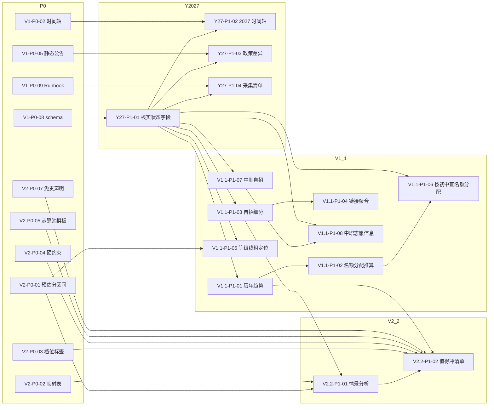

# P1 Issue 清单 — 深圳普高自主招生选校（2027 届升学季：V1.1 / V2.2 / 2027 数据核实）

> **用途**：供产品/研发拆分为 GitHub Issues；**本文不自动创建 Issue**。  
> **约束**：须符合 PRD 第 3 章决策 **D-1～D-4** 与 §6.1 P1 范围（见 `docs/PRD-self-recruitment.md`）。  
> **汇总**：共 **14** 条 P1（2027 数据核实：**4** 条；V1.1：**8** 条；V2.2：**2** 条）。  
> **范围变更（PRD V1.2）**：纳入中职/技工院校自主招生与第一批中职、第二批、第三批志愿信息；名额分配支持按所在初中查询；民办自招与公办二类完整纳入。  
> **年份口径**：2026 年为参考基线并附来源；2027 年规则与日期一律标 **需核实**，只写「参考 2026 年为 X」；非官方来源一律标 **非官方**。

---

## 使用说明

每条包含：**标题**、**描述**、**深圳 2026 事实依据**、**验收标准**、**建议 Labels**、**依赖**。  
Handoff 约定沿用 P0：编码前由 `self-recruitment-product` 产出 `docs/handoffs/<ID>.md`；实现按 `self-recruitment-implement`；由 `self-recruitment-verify` 判定 PASS/FAIL 后方可改 **Status**。

**与 P0 去重原则**：P0 18 条均已 done。P1 只做 P0 未覆盖的能力，或在 P0 组件上补 **2027 数据 / 内容增量**；不重做时间轴组件、静态公告组件、`scoreKind`、预估分区间、档位标签、硬约束与志愿池模板。

---

## 2027 数据核实 P1（年度可信、可追溯）

### Y27-P1-01 数据 schema 增补 `verifyStatus` 与 `sourceType`

**Status**: todo  
**Handoff**: 待产出（`docs/handoffs/Y27-P1-01.md`）

**描述**  
在 V1-P0-08（`scoreKind` + 年度字段）与 V1-P0-03（`year`/`fetchedAt`/`source` 展示）之上，**只增补两个字段**：`verifyStatus`（`verified-history` / `reference-2026` / `verified-2027` / `pending`）与 `sourceType`（`official` / `unofficial`）。UI 据此区分「历史已核实 / 2026 参考 / 2027 已核实 / 待发布」，并对非官方数据加「非官方」标注。

- `verified-history`：2026 年以前的官方历史数据，从官方原文原样提取，并经第二来源抽样核对（首批用例：`data/history/first-batch-2024.json`、`first-batch-2025.json`）。
- 派生字段（不是从该年份原文直接取得的值，例如 2024 年学校代码按 2025 年手册匹配）记入记录级 `derivedFields` 和 `derivedFrom`，UI 不必展示，但构建报告须列出。

**深圳 2026 事实依据**

- 2026 年起中考总分由 610 调整为 **630**，跨年对比须标注换算口径。来源：[深圳政府在线：2026 年中考招生政策公布](https://www.sz.gov.cn/cn/xxgk/zfxxgj/zwdt/content/post_12687796.html)
- 2026 年官方 **未公布一分一段表**，仅有等级线（转载自 **非官方** 来源）。来源：[自主选拔在线汇总（非官方）](https://www.zizzs.com/gk/zhongkao/224251.html)

**验收标准**

- [ ] `scores-*.json`、`zzzs-*.json`、`timeline-*.json` 及 `data/history/*.json` 每条记录含 `verifyStatus`，构建脚本按四值枚举校验，缺失则 CI 不通过  
- [ ] `derivedFields` 非空的记录在构建报告中单列（warn，不阻断）  
- [ ] `sourceType=unofficial` 的数据在卡片/表格/页脚均显示「非官方」标签，且附来源链接（`rel="noopener"`）  
- [ ] 2027 数据缺失时显示「待发布」，**不得**静默回退为 2026 数据而不标注  
- [ ] 不改动 `scoreKind` 既有枚举与 V1-P0-03 展示位置  

**Labels**：`p1`, `y2027`, `data`, `schema`  
**依赖**：V1-P0-08、V1-P0-03  

---

### Y27-P1-02 2027 年度时间轴数据（`timeline-2027.json`）

**Status**: todo  
**Handoff**: 待产出（`docs/handoffs/Y27-P1-02.md`）

**描述**  
复用 V1-P0-02 时间轴组件，**只新增 2027 年度配置数据**。未核实节点不写具体 2027 日期，展示「参考 2026 年为 X · 需核实」；官方发布后改为 `verified-2027`。

**深圳 2026 事实依据**（2027 均 **需核实**）

- 招考工作通知 3/13 签发、3/16 公布；中考报名 3/20–27，缴费 3/22–30。来源：[深教〔2026〕34 号](https://szeb.sz.gov.cn/home/jyfw/ksfw/zkgg/content/post_12687197.html)、[2026 年中考报名通知](https://szeb.sz.gov.cn/szzkw/qt/tzgg/content/post_12691041.html)
- 体育现场统一考试 4/13–30（网球 4/29、游泳 4/30）；英语听说 5/16–17；理化实验操作 5/23–24。来源：同上；[体育考试开考公告](https://szeb.sz.gov.cn/szzkw/qt/tzgg/content/post_12733322.html)、[理化实验考试完成公告](https://szeb.sz.gov.cn/szzkw/qt/tzgg/content/post_12803106.html)
- 名额分配资格名单 5/12 前公示；**考前**网上填报志愿 5/23 10:00–6/1 18:00。来源：[招考办「18 问 18 答」](https://szeb.sz.gov.cn/szszsksbgs/zkcx/zkzz/szs2026nzkzcjwsxc/tzgg/content/post_12803035.html)
- 自招简章 6/10 公布；报名 6/12–16；一类入围 6/23；文化课 6/26–28；自招考核 7/4–5；考核结果公示 7/6–10。来源：[2026 年自招批准通知](https://szeb.sz.gov.cn/gkmlpt/content/12/12833/post_12833273.html)
- 出分 7/16；复核申请 7/17 16:00 前；自招拟录取公示 7/20–24；7/25 上午自招批、下午名额分配批；7/26 上午第一批（12:00 公布分数线）、下午第二批；7/29 公布二次划线名单；7/30–31 第三批与二次划线填报；8/1 第三批；8/2 二次划线。来源：[成绩公布通知](https://szeb.sz.gov.cn/szzkw/qt/tzgg/content/post_12893343.html)、[各批次录取时间](https://szeb.sz.gov.cn/szzkw/zkgg/zkxx/content/post_12895674.html)、[第一批分数线公布](https://szeb.sz.gov.cn/szzkw/qt/tzgg/content/post_12909874.html)
- 体质测试每学年第一学期 9–12 月进行，初三须及格方可得满 9 分。来源：[体育考试实施意见](https://szeb.sz.gov.cn/home/xxgk/zthd/tyks/zcwj/content/post_11573961.html)
- 中职/技工院校自主招生：市教育局 4/24 通告 19 所学校；各校报名约 4/25–5/5、考核约 5/7–5/13、拟录取名单 5/15–5/18 前后报市招考办备案（各校不同，以学校章程为准）。来源：[2026 中职自招通告](https://szeb.sz.gov.cn/home/jyfw/ksfw/zkgg/content/post_12753894.html)、[深圳市第一职业技术学校章程](https://www.sz1z.net.cn/main/zzzs/11690.html)
- 《考生报考指导手册》（含名额分配附件 2、附件 3）5/21 发布。来源：[招考办手册页](https://szeb.sz.gov.cn/szszsksbgs/zkcx/zkzz/szs2026nzkzcjwsxc/ksbkzdsc/content/post_12803039.html)

**验收标准**

- [ ] 中职自招节点与手册发布节点纳入时间轴，标「参考 2026 年为 X · 需核实」  
- [ ] `data/timeline-2027.json` 覆盖上列全部节点，每条含 `verifyStatus`、官方 `source.url`、「家长要做什么」一句话  
- [ ] `pending` 节点仅显示「参考 2026 年为 X」，不显示 2027 具体日期  
- [ ] 来源冲突时以招考办为准（如非官方稿件将自招批/名额分配批写为 7/25、7/26 分日，不采用）  
- [ ] 2027 招考工作通知发布后 72h 内完成核实状态更新（对齐 PRD §10.2）  

**Labels**：`p1`, `y2027`, `content`, `static`  
**依赖**：V1-P0-02、Y27-P1-01  

---

### Y27-P1-03 年度政策差异条目（扩展静态更新公告）

**Status**: todo  
**Handoff**: 待产出（`docs/handoffs/Y27-P1-03.md`）

**描述**  
V1-P0-05 已提供静态更新公告（CHANGELOG 摘要）。P1 **只增补结构化「年度政策差异」条目**：类别、2026 值、2027 值、影响说明、来源，并在首页提示「上次访问后有新差异」（仅本地存储）。

**深圳 2026 事实依据**（作为差异对比的 2026 基线）

- 总分 630：语文 120；数学 100；英语 100（听说 25）；物理与化学合卷 140（物理 70、化学 50、实验 20）；历史 70；道德与法治 50（开卷）；体育与健康 50（现场 36 + 过程性评价 14）。来源：[深教〔2026〕34 号](https://szeb.sz.gov.cn/home/jyfw/ksfw/zkgg/content/post_12687197.html)
- 志愿：自主招生批 1 个、名额分配批 1 个、第一批 16 个（普高 12 个，可勾选不超过 4 所「接受走读调剂」）、第二批 18 个、第三批 6 个。来源：同上
- 名额分配：公办普高招生计划 50%；控制线 = 该校前三年同类别录取线平均值 − 20（按 630 换算）。来源：同上，附件 1

**验收标准**

- [ ] `data/changelog.json`（或 V1-P0-05 既有载体）支持 `type=policy-diff` 条目，字段为 `category`、`before2026`、`after2027`、`impact`、`source`  
- [ ] 至少预置类别：总分与科目、志愿数、名额分配、自主招生、体育、日程；2027 值未发布时为「待发布」  
- [ ] 「有新差异」提示仅用 `localStorage`，无网络写操作  
- [ ] 不新增公告组件，复用 V1-P0-05 渲染  

**Labels**：`p1`, `y2027`, `ops`, `static`  
**依赖**：V1-P0-05、Y27-P1-01  

---

### Y27-P1-04 2027 升学季采集与核实清单（Runbook 增补）

**Status**: todo  
**Handoff**: 待产出（`docs/handoffs/Y27-P1-04.md`）

**描述**  
在 V1-P0-09 Runbook 中增补 **2027 采集清单**：按官方发布节点列出要抓取/录入的文件、负责角色、核实方法与 72h SLA，确保 `verifyStatus` 从 `pending` 迁移有据可查。

**深圳 2026 事实依据**（各类文件 2026 年发布时点，2027 **需核实**）

- 招考工作通知与名额分配实施办法：3 月中旬。来源：[深教〔2026〕34 号](https://szeb.sz.gov.cn/home/jyfw/ksfw/zkgg/content/post_12687197.html)
- 体育评分标准：2026 年版于 2025-06-06 发布；**2027 年版截至 2026-11-18 未检索到**。来源：[2026 年评分标准通知](https://szeb.sz.gov.cn/szzkw/zcwj/content/post_12216269.html)
- 招生计划及代码、考生报考指导手册（含名额分配控制线）：5 月下旬（转载见 [深圳本地宝（非官方）](http://sz.bendibao.com/edu/2026529/1003697.shtm)）
- 自招批准通知、简章与控制分：6 月上旬。来源：[2026 年自招批准通知](https://szeb.sz.gov.cn/gkmlpt/content/12/12833/post_12833273.html)
- 等级线：7/16 随成绩公布；各批次录取线：7/26 起。来源：[成绩公布通知](https://szeb.sz.gov.cn/szzkw/qt/tzgg/content/post_12893343.html)
- 中职自招通告：4/24。来源：[2026 中职自招通告](https://szeb.sz.gov.cn/home/jyfw/ksfw/zkgg/content/post_12753894.html)
- 《考生报考指导手册》PDF（附件 3 为名额分配到各初中的明细）：5/21 发布，距志愿开放（5/23）仅约 2 天。来源：[招考办手册页](https://szeb.sz.gov.cn/szszsksbgs/zkcx/zkzz/szs2026nzkzcjwsxc/ksbkzdsc/content/post_12803039.html)

**验收标准**

- [ ] **检查任务**：核实 2027 年体育评分标准是否已发布（参考：2026 年版于 2025-06-06 发布，见上方链接）；未发布则保持 `pending`，每月复查一次直至发布  
- [ ] 清单含中职自招通告、手册附件 2/3 两项采集，附件 3 导入脚本须在手册发布前用 2026 数据演练通过  
- [ ] 清单含中职 / 技工院校章程收费采集（随中职自招通告和各校章程，供 V1.1-P1-07 `fee` 字段使用）及 2027 年自招拟录取公示采集（供 V2.2-P1-01 下一年校准）  
- [ ] `docs/runbook-data-release.md` 新增「2027 采集清单」小节，逐项含：文件名、预计时点（参考 2026）、官方栏目 URL、产物文件、核实人  
- [ ] 每项定义 `pending → verified-2027` 的核实动作（原文比对 / 双人复核）  
- [ ] 非官方来源条目须注明替代的官方来源与替换时点  

**Labels**：`p1`, `y2027`, `ops`, `docs`  
**依赖**：V1-P0-09、Y27-P1-01  

---

## V1.1 P1（数据完整度）

### V1.1-P1-01 历年一批录取线趋势（610 → 630 换算）

**Status**: todo  
**Handoff**: 待产出（`docs/handoffs/V1.1-P1-01.md`）

**描述**  
展示 2024–2026 年各校、各招生类别（AC/D/ACD）第一批录取线走势，作为判断「保」档稳定性的依据。610 分制年份按 ×630/610 换算并标注「换算值」。

**深圳 2026 事实依据**

- 2026 年总分 630，2025 年为 610。来源：[深圳政府在线](https://www.sz.gov.cn/cn/xxgk/zfxxgj/zwdt/content/post_12687796.html)
- 官方在名额分配控制线中采用「同比例换算为满分 630 分对应的分数」，本 Issue 沿用同一口径。来源：[深教〔2026〕34 号 附件 1](https://szeb.sz.gov.cn/home/jyfw/ksfw/zkgg/content/post_12687197.html)
- 2026 年第一批录取线于 7/26 公布。来源：[第一批分数线公布](https://szeb.sz.gov.cn/szzkw/qt/tzgg/content/post_12909874.html)
- 2025 年起公办普高第一批分「住宿 / 走读」两条线；2024 年每校每类别只有一条。来源：[2025 年第一批录取标准](https://szeb.sz.gov.cn/szzkw/qt/tzgg/content/post_12297645.html)、[2024 年第一批录取标准](https://szeb.sz.gov.cn/szzkw/zkgg/zkxx/content/post_11470299.html)

**前置数据现状（2026-11-18）**

- **2024、2025 年已下载到 `data/history/`**：`first-batch-2024.json` 227 条、`first-batch-2025.json` 393 条（普高，含公办和民办，含 2 所中职学校的综合高中班）。
  - 来源：官方 [2023—2025 年录取标准查询页](https://szeb.sz.gov.cn/szzkw/ztzl/szzkjsnlqfsxcx/) 内嵌数据，`sourceType=official`、`verifyStatus=verified-history`。
  - 核实状态：分数和末位同分条件已与官方公告附件图片抽核一致（2024 年 125 条，2025 年 13 条），头部 4 校与深圳政府在线新闻稿一致。
  - 2024 年 `schoolCode` / `category` 为派生值（按 2025 年手册校名匹配，7 条取自 2024 年公告图片），记录在 `derivedFields`；其中 125 条已与 2024 年公告图片核对一致。
  - 原始附件在 `data/history/raw/`（公告图片、2025 年手册 PDF、查询页快照）。
- 字段为 `score`（原始 610）、`fullScore`、`score630`（换算值，1 位小数）+ `score630Label=换算值`、`accommodation`（住宿 / 走读 / null）、`tieBreak`（生物地理、语数英三科总分）。并入正式数据前，须与现有 `scores-*.json` 的字段名和 `scoreKind` 枚举对齐（handoff 确认）。
- **2026 年一批线**：是否已在现有数据中、字段是否一致，由 handoff 确认；缺失则按上方 2026 链接采集。

**验收标准**

- [ ] 数据含 2024、2025、2026 三年一批线，每条带 `year`、`scoreKind=录取线`、`fullScore`（610/630）、`source`、`verifyStatus`；2024/2025 从 `data/history/` 导入，不重新采集  
- [ ] 2025 年及以后住宿 / 走读两条线分别展示，2024 年单线不得被误标为住宿或走读  
- [ ] 换算值与原始值同时可见，换算值有「换算」标签  
- [ ] 校名经 `data/school-aliases.json` 与 `supplement.json` 归一，无法关联者按 V1-P0-07 报告阻断  
- [ ] 学校卡片或对比视图可展示三年走势（静态，无图表库依赖或沿用现有样式）  

**Labels**：`p1`, `v1.1`, `data`, `feature`  
**依赖**：V1-P0-07、V1-P0-08、Y27-P1-01  

---

### V1.1-P1-02 名额分配控制线推算与专题增补

**Status**: todo  
**Handoff**: 待产出（`docs/handoffs/V1.1-P1-02.md`）

**描述**  
V1-P0-01 已有名额分配资格线含义说明，V1-P0-04 已有「名额分配 ≠ 到校指标分」FAQ。P1 **只补**：按 2026 公式用 2024–2026 一批线推算 2027 各校名额分配控制线（标「按 2026 规则推算 · 需核实」），2027 手册发布后替换为官方值；补充资格条件与「1 所、与第一批独立」说明。

**深圳 2026 事实依据**

- 公办普高 50% 计划用于名额分配；范围与学校招生范围一致（AC / D / ACD）。来源：[深教〔2026〕34 号 附件 1](https://szeb.sz.gov.cn/home/jyfw/ksfw/zkgg/content/post_12687197.html)
- 控制线 = 该校前三年（2023–2025）相应类别录取线（换算 630）平均值 − 20；新建校缺年份用全市公办同类第一批最低线替代；与当年第一批录取线无关。来源：同上
- 资格：符合划线录取条件的应届生；初一第一学期起在本校就读并有三年学籍（市外转入须初三第一学期起在读）。来源：[招考办「18 问 18 答」](https://szeb.sz.gov.cn/szszsksbgs/zkcx/zkzz/szs2026nzkzcjwsxc/tzgg/content/post_12803035.html)
- 2027 年公式与年份窗口（是否为 2024–2026）**需核实**。

**前置数据现状（2026-11-18）**

- 2024、2025 年一批线**已下载到 `data/history/`**（核实状态见 V1.1-P1-01）；2026 年一批线由 V1.1-P1-01 补齐。
- 官方查询页同时含 2023 年数据（已随 `data/history/raw/pgScoreData-official.json` 保存，未单独整理成文件），可用于回测 2026 年控制线。
- 2025 年住宿 / 走读两条线在平均值中取哪一条，2026 年官方口径 **需核实**（以 2026 年手册附件 2 反推）。

**验收标准**

- [ ] **回测**：用 2023–2025 年线按 2026 公式算出 2026 年控制线，与 2026 年手册附件 2 官方值逐校比对，差异输出报告；回测通过（或差异可解释）后才发布 2027 推算值  
- [ ] 推算值带 `scoreKind=资格线`、`verifyStatus=pending`、计算口径说明（年份窗口、换算、−20）  
- [ ] 2027 官方值入库后推算值自动隐藏，仅保留官方值  
- [ ] 文案明确「控制线是资格线，不是录取线」，与 `rules.js` 术语一致  
- [ ] 控制线以「学校 × 类别」为粒度输出，供 V1.1-P1-06 按初中查询时复用  

**Labels**：`p1`, `v1.1`, `data`, `content`  
**依赖**：V1.1-P1-01、V1-P0-01、V1-P0-04  

---

### V1.1-P1-03 自招项目细分补全（公办一类 / 公办二类 / 民办）

**Status**: todo  
**Handoff**: 待产出（`docs/handoffs/V1.1-P1-03.md`）

**描述**  
完整覆盖 **公办一类**（理工科技 / 人文社科）、**公办二类**（艺术 / 体育）与 **民办普高自招** 的项目细分、计划数、控制分与报名渠道。公办二类为 **现场报名**，须在数据与 UI 中明确标出；二类按「体育 / 艺术」分列中考成绩控制线。硬约束提示沿用 V2-P0-04，不重复实现。

**深圳 2026 事实依据**

- 公办一类与民办自招统一在自主招生管理平台（`https://www.szzk.edu.cn/zzzs`）网上报名，6/12–16；**公办二类须现场报名**，同为 6/12–16，按二类工作方案执行。来源：[2026 年自招批准通知](https://szeb.sz.gov.cn/gkmlpt/content/12/12833/post_12833273.html)
- 一类和二类不能兼报、公办和民办不能兼报、同校不同项目不能兼报；仅可报 1 所学校的 1 个项目。来源：同上
- 合成总分 = 中考成绩 60% + 项目考核 40%（均折算百分制）；中考成绩不得低于学校控制线；控制线与当年第一批录取线无关。来源：同上
- 二类须「双达线」（中考控制线 + 专项合格线）。来源：[二类自招方案（转载，非官方）](https://sz.bendibao.com/edu/2026612/1005615.shtm)
- 2026 年部分学校二类控制分按体育 / 艺术分列（如红岭体育 495、艺术 545）。来源：[二类拟录取公示汇总（转载，非官方）](https://sz.bendibao.com/edu/2026720/1008148.shtm)

**验收标准**

- [ ] `zzzs-*.json` 每个项目含 `ownership`（公办/民办）、`category`（一类/二类；民办按简章口径）、`track`（理工科技/人文社科/艺术/体育）、`subject`、`plan`、`controlScore`、`applyMode`（平台网报/现场报名）  
- [ ] 公办二类项目在卡片与筛选中显示「现场报名」标签，并链接该校简章中的现场报名地点与材料要求（缺失显示「待发布」）  
- [ ] 民办自招项目可与公办在同一列表筛选，支持按 `ownership` 过滤；民办收费沿用现有收费数据关联  
- [ ] 二类分列控制分时数据与 UI 均能区分体育 / 艺术  
- [ ] 转载来源条目标 `sourceType=unofficial`，官方原文可得时替换  

**Labels**：`p1`, `v1.1`, `data`  
**依赖**：V1-P0-07、V1-P0-08、Y27-P1-01  

---

### V1.1-P1-04 招生手册与自招简章链接聚合

**Status**: todo  
**Handoff**: 待产出（`docs/handoffs/V1.1-P1-04.md`）

**描述**  
在学校卡片与填报指南中聚合官方链接：考生报考指导手册、招生简介、各校自招简章（公办一类、公办二类、民办）、自招拟录取公示；公办二类额外聚合现场报名须知。报名窗口短，信息一次找全。

**深圳 2026 事实依据**

- 市招考办编印《考生报考指导手册》《招生简介》，经初中学校发放，并可经深圳招考网查询。来源：[招考办「18 问 18 答」](https://szeb.sz.gov.cn/szszsksbgs/zkcx/zkzz/szs2026nzkzcjwsxc/tzgg/content/post_12803035.html)
- 各校须于 6/10 前在学校网站公布自招简章；一类与民办自招统一使用自主招生管理平台（`https://www.szzk.edu.cn/zzzs`）。来源：[2026 年自招批准通知](https://szeb.sz.gov.cn/gkmlpt/content/12/12833/post_12833273.html)

**验收标准**

- [ ] 每校最多 4 类链接（手册 / 简介 / 简章 / 公示），缺失显示「待发布」；公办二类另加「现场报名须知」链接  
- [ ] 民办自招简章与公办同等覆盖  
- [ ] 外链均 `rel="noopener"`，并显示 `fetchedAt`  
- [ ] 学校官网或公众号链接标注来源类型；**非官方**聚合页不得作为唯一来源  

**Labels**：`p1`, `v1.1`, `content`  
**依赖**：V1.1-P1-03、V1-P0-03  

---

### V1.1-P1-05 2026 等级线粗定位（非官方，可选）

**Status**: todo  
**Handoff**: 待产出（`docs/handoffs/V1.1-P1-05.md`）

**描述**  
深圳无官方一分一段表。用 2026 总分等级线把分数映射为「约前 X%」的粗略位置，辅助 V2-P0-01 的预估区间理解。数据与页面 **必须标「非官方」**。

**深圳 2026 事实依据**

- 单科等级比例 A+ 5%、A 20%、B+ 25%、B 25%、C+ 20%、C 5%（官方）。来源：[深教〔2026〕34 号](https://szeb.sz.gov.cn/home/jyfw/ksfw/zkgg/content/post_12687197.html)
- 2026 总分等级线 A+ 588 / A 552 / B+ 505 / B 389（**非官方**）。来源：[城市学校网（非官方）](https://szxuexiao.com/news/html/2026/07/3840.html)

**验收标准**

- [ ] 数据带 `sourceType=unofficial`，UI 每处显示「非官方 · 粗略」  
- [ ] 仅输出区间档（前 5% / 25% / 50% / 75%），不输出精确位次  
- [ ] 找到官方原文后可切换为 `official`  
- [ ] 不影响 V2-P0-02 映射表默认参数  

**Labels**：`p1`, `v1.1`, `data`, `optional`  
**依赖**：Y27-P1-01、V2-P0-01  

---

### V1.1-P1-06 按所在初中查询名额分配计划

**Status**: todo  
**Handoff**: 待产出（`docs/handoffs/V1.1-P1-06.md`）

**描述**  
用户选择所在初中（及考生类别 AC / D / ACD），即可看到本校分到各公办普高的名额分配计划数，并配上该高中名额分配控制线（V1.1-P1-02）。区内共享名额单列。选择结果仅存本地 / URL，不上传。

**深圳 2026 事实依据**

- 全市公办普高均将招生计划 50% 作为名额分配计划，分配到全市所有公民办初中；AC / D / ACD 分开计算，D 类有区内共享规则。来源：[深教〔2026〕34 号 附件 1](https://szeb.sz.gov.cn/home/jyfw/ksfw/zkgg/content/post_12687197.html)
- 各高中名额分配计划数与控制线见《考生报考指导手册》附件 2；分到各初中的具体数量见 **附件 3**「公办普通高中名额分配招生计划分配情况表」。手册 2026-05-21 发布。来源：[招考办手册页](https://szeb.sz.gov.cn/szszsksbgs/zkcx/zkzz/szs2026nzkzcjwsxc/ksbkzdsc/content/post_12803039.html)
- 第三方整理称 2026 年涉及 96 所公办普高、490 所初中，且矩阵合计与全市计划存在差额（**非官方**，仅作规模估计，不作数据源）。来源：[江游老师名额分配查询（非官方）](https://jiangyoulaoshi.com/zhongkao-quota-query.html)
- 2027 年附件 3 预计 5 月下旬随手册发布（参考 2026 年为 5/21），**需核实**；距志愿开放（参考 2026 年为 5/23）仅约 2 天。

**验收标准**

- [ ] 数据集 `quota-YYYY.json` 以「初中 × 高中 × 类别」为行，字段含 `juniorSchool`、`seniorSchool`、`category`（AC/D/ACD）、`quota`、`sharedInDistrict`（区内共享标记）、`year`、`source`（手册附件 3 原文链接）、`fetchedAt`、`verifyStatus`  
- [ ] 2026 全量从手册附件 3 采集，构建时校验：各高中分到初中的合计与附件 2 计划数比对，差额输出报告（warn，不静默）  
- [ ] **初中校名归一**：沿用 V1-P0-07 别名表与 `supplement.json` 约定，为初中建立独立命名空间；无法归一的初中名列出报告并按 V1-P0-07 配置 warn/fail  
- [ ] 前端：选择初中（支持搜索与别名）+ 类别后，列出可用高中、名额数、控制线（V1.1-P1-02，标资格线），并提示资格条件（初一起在本校就读三年学籍等）  
- [ ] 2027 数据未发布时显示 2026 数据并标「2026 参考」；发布后 48h 内替换，导入脚本须提前用 2026 数据演练  
- [ ] 不判断考生个人是否具备资格，仅展示官方条件原文链接  

**Labels**：`p1`, `v1.1`, `data`, `feature`, `pipeline`  
**依赖**：V1.1-P1-02、V1-P0-07、V1-P0-08、Y27-P1-01  

---

### V1.1-P1-07 中职 / 技工院校自主招生信息

**Status**: todo  
**Handoff**: 待产出（`docs/handoffs/V1.1-P1-07.md`）

**描述**  
新增中职 / 技工院校自主招生信息：获批学校、计划数、专业 / 特长项目、报名渠道与时间、考核方式、录取规则、**收费信息**（学费、住宿费、免学费条件）。突出与普高自招的差异：**在中考前、志愿填报前开展；录取后须参加中考但不再填报中考志愿，不得退档转录**。仅做信息整合与筛选，不进入冲稳保推荐。

**深圳 2026 事实依据**

- 市教育局 2026-04-24 通告：19 所中职学校及技工院校获批自主招生；招生对象为参加深圳中考且符合划线录取资格的考生，**户籍不限**，**每位考生限报一所**自主招生学校；通告列出各校计划与网址。来源：[2026 中职自招通告](https://szeb.sz.gov.cn/home/jyfw/ksfw/zkgg/content/post_12753894.html)
- 中职自招在志愿填报前开展，名额原则上不超过本校年度招生计划 30%；录取后不再填报中考志愿，须参加全市统一中考，不得退档转录。来源：[深教〔2026〕34 号](https://szeb.sz.gov.cn/home/jyfw/ksfw/zkgg/content/post_12687197.html)
- 各校自定报名与考核安排，例如深圳市第一职业技术学校：4/27–4/30 网上报名，5/10 笔试，5/13 专项测试，5/15 公布拟录取，5/18 报市招考办备案。来源：[深圳市第一职业技术学校章程](https://www.sz1z.net.cn/main/zzzs/11690.html)
- 部分学校另设中考成绩控制线（例如盐港中学体育 330 / 美术 420 / 音乐 400），口径因校而异。来源：[盐港中学章程（转载，非官方）](https://c.460.net.cn/a/567823.html)
- 2027 年获批名单、计划与日程 **需核实**（参考 2026 年通告为 4/24）。
- **收费**：公办中职按市发改部门核定标准收费，符合条件的学生（深圳户籍、农村（含县镇）、涉农专业、城市家庭经济困难、符合「1+5」文件的其他城市学生等）免学费，艺术类表演专业除外；住宿费多为 450 元/学期。民办中职对符合条件者按公办标准补助，高出部分可继续收取。来源：[招考办公办中职学校介绍（例：深圳市第三职业技术学校）](https://szeb.sz.gov.cn/szzkw/ztzl/gzjdxxbxtsjs/gbzz/content/post_12089875.html)、[市教育局：公办中职免学费问答](https://szeb.sz.gov.cn/home/zdyw/xszz/xszz_cjwt/content/post_10134432.html)、[市教育局：民办中职免学费问答](http://szeb.sz.gov.cn/home/zdyw/xszz/xszz_cjwt/content/post_10184591.html)
- 具体金额以各校当年章程为准，例如深圳市第一职业技术学校：不符合免学费条件者 1595 元/学期。来源：[深圳市第一职业技术学校章程](https://www.sz1z.net.cn/main/zzzs/11690.html)。其他学校在 2025 年章程中为 1250–1595 元/学期（转载，**非官方**）。来源：[中职自招计划汇总（转载，非官方）](https://c.460.net.cn/a/565349.html)

**验收标准**

- [ ] 数据集含每校 `name`、`plan`、`majors`/`projects`、`applyWindow`、`exam`、`controlScore`（如有）、`url`、`source`、`fetchedAt`、`verifyStatus`、`sourceType`  
- [ ] **收费字段**：每校含 `fee`（`tuitionPerTerm`、`boardingPerTerm`、`feeBasis`、`freeTuitionNote`、`feeSource`、`feeYear`）。来源优先级为：① 当年学校章程或简章原文（学校官网）；② 招考办学校介绍页的「收费标准」；③ 转载（标 `sourceType=unofficial`）。只写「按发改核定标准」而没有金额的，`tuitionPerTerm` 留空并显示「以学校公布为准」，不得估算  
- [ ] 页面同时展示免学费条件与官方问答链接，不判断考生个人是否符合免学费条件  
- [ ] 2026 年收费数据须注明 `feeYear=2026`；2027 年章程发布前显示「2026 参考」  
- [ ] 中职收费不并入现有普高收费 Tab 的计算或排序，可在中职卡片内单独展示  
- [ ] 页面展示「中职自招 vs 普高自招」差异对照（时点、是否还填志愿、限报规则），文案与 `rules.js` 同源维护（V1-P0-04 机制）  
- [ ] 校名归一沿用 V1-P0-07；与第二批中职学校数据（V1.1-P1-08）可关联  
- [ ] 不进入 V2-P0-03 档位标签与 V2.2 清单；不输出录取概率  
- [ ] 2027 通告发布后 72h 内更新  

**Labels**：`p1`, `v1.1`, `data`, `content`, `scope-change`  
**依赖**：Y27-P1-01、V1-P0-07、V1-P0-03、V1-P0-04  

---

### V1.1-P1-08 第一批中职 / 第二批 / 第三批志愿信息

**Status**: todo  
**Handoff**: 待产出（`docs/handoffs/V1.1-P1-08.md`）

**描述**  
现网已有二批 / 二次划线 / 三批资格线与官方原图（PRD 用户故事 E）。P1 **只补**：中职志愿结构说明与学校 / 专业目录（第一批中的中职试点专业、第二批本市中职及技工院校、第三批部省属及跨市中职），以及三二分段、长学制、中本贯通等专业的报考条件。

**深圳 2026 事实依据**

- 第一批 16 个志愿中含中职学校及技工院校志愿 4 个；第一批中职为国家中职示范校、国家级重点中职、省级重点中职和国家级重点技工院校试点专业（每校不超过两个专业）。来源：[深教〔2026〕34 号](https://szeb.sz.gov.cn/home/jyfw/ksfw/zkgg/content/post_12687197.html)
- 第二批 18 个志愿：本市中等职业学校及技工院校（除第一批录取专业外）。第三批 6 个志愿：部省属（含跨市）中职，在二次划线前另行填报。来源：[招考办「18 问 18 答」](https://szeb.sz.gov.cn/szszsksbgs/zkcx/zkzz/szs2026nzkzcjwsxc/tzgg/content/post_12803035.html)
- 2026 日程：7/26 下午第二批录取；7/29 公布第二次划线名单；7/30–31 第三批与二次划线志愿填报；8/1 第三批由广东省教育考试院组织录取；8/2 第二次划线录取。来源：[各批次录取时间](https://szeb.sz.gov.cn/szzkw/zkgg/zkxx/content/post_12895674.html)、[第一批分数线公布](https://szeb.sz.gov.cn/szzkw/qt/tzgg/content/post_12909874.html)
- 填报三二分段、长学制、中本贯通专业志愿的考生须为应届初中毕业生。来源：[招考办「18 问 18 答」](https://szeb.sz.gov.cn/szszsksbgs/zkcx/zkzz/szs2026nzkzcjwsxc/tzgg/content/post_12803035.html)
- 2027 年志愿数与日程 **需核实**。

**验收标准**

- [ ] 填报指南（V1-P0-01）新增「中职志愿」小节：各批次志愿数、学校范围、填报时点、录取后不退档不转录  
- [ ] 数据集列出第一批中职试点专业、第二批学校 / 专业、第三批学校名单（来自招生计划及代码表与第三批附件），带 `batch`、`schoolType`（中职/技工）、`major`、`source`、`verifyStatus`  
- [ ] 三二分段 / 长学制 / 中本贯通专业带「仅限应届生」标签  
- [ ] 与现有二批 / 二次划线 / 三批资格线展示（用户故事 E）复用同一数据关联，不重复造表  
- [ ] 不提供中职专业录取预测或档位标签  

**Labels**：`p1`, `v1.1`, `data`, `content`, `scope-change`  
**依赖**：V1-P0-01、V1-P0-07、V1-P0-08、Y27-P1-01、V1.1-P1-07  

---

## V2.2 P1（自招决策增强）

### V2.2-P1-01 合成总分情景分析

**Status**: todo  
**Handoff**: 待产出（`docs/handoffs/V2.2-P1-01.md`）

**描述**  
扩展现有规则计算器：以 V2-P0-01 预估分区间（默认保守端）为中考成绩输入，叠加项目考核分若干情景，输出合成总分区间并对照学校控制分。情景参数做成版本化配置数据，首版用占位默认值并标注「待定」，定稿后只改数据不改代码。

**参数负责人与校准**

- **owner：产品负责人**。由产品负责人决定情景个数和取值并签字定稿；数据 QA 负责执行校准并出报告。
- **数据来源**：
  - 2026 年各校自招拟录取公示（官方，各校官网，公示期 7/20–24）。来源：[2026 年自招批准通知](https://szeb.sz.gov.cn/gkmlpt/content/12/12833/post_12833273.html)
  - 2026 年一类控制线、二类拟录取汇总（转载，**非官方**，只作补充，不单独作为定稿依据）。来源：[一类控制线汇总（非官方）](https://sz.bendibao.com/edu/2026612/1005650.shtm)、[二类拟录取公示汇总（非官方）](https://sz.bendibao.com/edu/2026720/1008148.shtm)
  - 2026 年学校控制分：V1.1-P1-03 数据集。
- **校准方法**：
  1. 按「学校 × 项目 × 一类/二类」收集 2026 年拟录取样本中公示的合成总分（以及中考成绩，如公示）。
  2. 两者都公示时，按合成总分 = 中考百分制 × 60% + 项目考核百分制 × 40% 反推项目考核分；只公示合成总分时，记录最低合成分和中位合成分。
  3. 按一类 / 二类分别计算反推项目考核分（或合成分）的分位数，作为情景候选值（例如 P25 / P50 / P75 对应保守 / 中性 / 乐观，具体个数和分位由 owner 定）。
  4. 用候选值回测：把 2026 年控制分和公示样本代入计算器，检查「是否低于控制分」的判断与公示结果一致；不一致的学校列入报告。
  5. owner 审阅报告后定稿，配置 `status` 改为 `已定稿`，`changelog` 记录版本、样本量、来源链接。
- 公示字段（是否含合成总分、中考成绩、项目考核分）因校而异，**需核实**；样本不足的学校 / 项目沿用全市同类分位数，并在报告中标出。

**深圳 2026 事实依据**

- 合成总分 = 中考成绩与项目考核成绩折算百分制后按 60% / 40% 合成；同分先比项目考核成绩。来源：[2026 年自招批准通知](https://szeb.sz.gov.cn/gkmlpt/content/12/12833/post_12833273.html)
- 自招报名在志愿锁定后、中考前（2026：志愿 6/1 截止，报名 6/12–16，文化课 6/26–28），决策时只有预估分。来源：同上；[招考办「18 问 18 答」](https://szeb.sz.gov.cn/szszsksbgs/zkcx/zkzz/szs2026nzkzcjwsxc/tzgg/content/post_12803035.html)

**验收标准**

- [ ] 输入读取 `shared.myScore`，默认 `riskPreset=conservative`，切换需沿用 V2-P0-01 二次确认  
- [ ] 情景参数存于版本化配置（`data/mapping-v1.json` 新增段或独立 `data/scenario-v1.json`，由 handoff 定），含 `version`、`effectiveYear`、`status`（`待定` / `已定稿`）、`owner`、变更说明；情景个数与各情景取值均由配置决定，代码无硬编码数值  
- [ ] `status=待定` 时，界面在情景结果旁显示「参数待定 · 仅供演示」  
- [ ] 配置 `owner=产品负责人`；附校准报告（样本量、分位数、回测不一致清单、来源链接），定稿前须经产品负责人确认  
- [ ] 修改配置取值后无需改代码即可生效（以替换配置文件的手工测试验证）  
- [ ] 输出为分数区间与「是否低于控制分」，**不输出录取概率 %**  
- [ ] 计算逻辑与 `rules.js` 计算器同源，不出现两套公式  

**Labels**：`p1`, `v2.2`, `feature`, `reco`  
**依赖**：V2-P0-01、V2-P0-02、V1.1-P1-03  

---

### V2.2-P1-02 「值得冲」自招清单

**Status**: todo  
**Handoff**: 待产出（`docs/handoffs/V2.2-P1-02.md`）

**描述**  
基于情景分析与一批线对照，为自招学校打 **仅自招 / 冲 / 稳 / 保 / 不推荐** 标签（PRD §8.3），并提示「自招录取后后续批次作废」：若自招校不优于第一批冲档，给出风险提示。

**深圳 2026 事实依据**

- 被普高自招录取的考生，后续各批次志愿失效。来源：[招考办「18 问 18 答」](https://szeb.sz.gov.cn/szszsksbgs/zkcx/zkzz/szs2026nzkzcjwsxc/tzgg/content/post_12803035.html)
- 自招控制线仅用于自招批次，不能作为第一批志愿参考（例：2026 一类控制线红岭 545、深圳中学 534，630 分制，转载 **非官方** 汇总）。来源：[2026 年自招批准通知](https://szeb.sz.gov.cn/gkmlpt/content/12/12833/post_12833273.html)、[一类控制线汇总（非官方）](https://sz.bendibao.com/edu/2026612/1005650.shtm)

**验收标准**

- [ ] 标签可追溯规则 ID + 所用字段（预估分区间、控制分、一批线），沿用 V2-P0-03 机制  
- [ ] 硬约束（1 校 1 项目、一类二类/公办民办不可兼报、AC/D 可比集合）调用 V2-P0-04，不另写  
- [ ] 首次展示清单时触发 V2-P0-07 免责声明；固定文案与 V2-P0-05「自招录取则后续批次作废」一致  
- [ ] 默认保守档；无概率 %；无网络写操作  

**Labels**：`p1`, `v2.2`, `feature`, `reco`  
**依赖**：V2.2-P1-01、V2-P0-03、V2-P0-04、V2-P0-05、V2-P0-07、V1.1-P1-01  

---

## 依赖关系简图

---

## P1 标题速查表

| ID | 标题 |
|----|------|
| Y27-P1-01 | 数据 schema 增补 verifyStatus 与 sourceType |
| Y27-P1-02 | 2027 年度时间轴数据（timeline-2027.json） |
| Y27-P1-03 | 年度政策差异条目（扩展静态更新公告） |
| Y27-P1-04 | 2027 升学季采集与核实清单（Runbook 增补） |
| V1.1-P1-01 | 历年一批录取线趋势（610 → 630 换算） |
| V1.1-P1-02 | 名额分配控制线推算与专题增补 |
| V1.1-P1-03 | 自招项目细分补全（公办一类 / 公办二类 / 民办） |
| V1.1-P1-04 | 招生手册与自招简章链接聚合 |
| V1.1-P1-05 | 2026 等级线粗定位（非官方，可选） |
| V1.1-P1-06 | 按所在初中查询名额分配计划 |
| V1.1-P1-07 | 中职 / 技工院校自主招生信息 |
| V1.1-P1-08 | 第一批中职 / 第二批 / 第三批志愿信息 |
| V2.2-P1-01 | 合成总分情景分析 |
| V2.2-P1-02 | 「值得冲」自招清单 |

---

## 待确认

1. 2027 体育评分标准是否已发布：未知，由 Y27-P1-04 检查任务跟踪（参考 2026 年版发布于 2025-06-06）。  
2. V1.1-P1-06 初中校名归一：初中是否并入现有别名表文件，还是另建文件（由 handoff 决定，须符合 D-4）。  
3. `data/history/*.json` 与现有 `scores-*.json` 的字段名、`scoreKind` 枚举是否一致：本次未读现有数据文件，由 V1.1-P1-01 handoff 对齐（如需改名，在导入脚本中映射，不改 `data/history/` 原件）。  
4. 2026 年名额分配控制线对 2025 年住宿 / 走读两条线取哪一条：由 V1.1-P1-02 回测确认。  

**已关闭**：名额分配按初中查询 → 纳入 V1.1-P1-06；民办自招与公办二类 → 纳入 V1.1-P1-03 / 04；中职自招与第二、三批 → 纳入 V1.1-P1-07 / 08（PRD V1.2 范围变更）；用户分层编号 → PRD 已改为 U1–U5；2024/2025 一批线 → 已下载到 `data/history/`（V1.1-P1-01）；V2.2 情景参数 → owner 为产品负责人，用 2026 年自招拟录取数据校准（V2.2-P1-01）；中职收费 → 纳入 V1.1-P1-07。  
